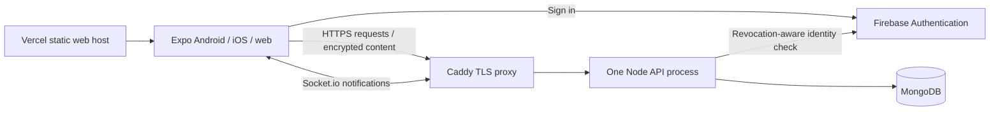

# Architecture decisions

Status: accepted for the Android release candidate. Last reviewed: 2026-09-08.

## Product scope

Text history and private expiring text links across signed-in devices. Automatic clipboard access is opt-in and foreground-only. The application does not transfer files/images, monitor background clipboard changes, or guarantee sub-50ms delivery.

## Components

| Layer | Responsibility |
| --- | --- |
| Routes and components | Input, consent, loading/error feedback and display |
| AuthContext | Firebase session, encryption readiness, logout cleanup |
| useAccountGuard | Invalidate async work across account changes, locking and unmounts |
| useClipboardSync | Fetch snapshots, reconcile foreground clipboard state, deduplicate notifications, update UI after writes |
| apiService | Authenticated REST, request errors, 15-second timeouts |
| socketService | One account-bound connection; notifications and reconnect |
| cryptoService | AES-GCM, scrypt, random tokens and envelope parsing; no storage or network |
| keyService / keyStore | Wrap/unlock/recover keys; SecureStore on native and sessionStorage on web |
| API middleware | Authentication, recent-login checks, validation, request limits and per-user mutation locking |
| Backend clipboard service | Shared REST/legacy-socket create validation and idempotency |
| MongoDB models | Durable encrypted content, profile/device metadata, key envelopes and share expiry |

## Write and sync contract

REST is the authoritative path for new clients. A clipboard save gets a UUID request ID before transmission. A lost network response is retried once with the same ID and ciphertext. The backend has a partial unique index on `{userId, requestId}`. A confirmed save updates the originating UI immediately.

Socket.io delivers `clipboard:new`, `clipboard:deleted` and `clipboard:cleared` after persistence. Notifications may be duplicated or missed; clients deduplicate by document ID and fetch a REST snapshot on connection, foreground and visibility changes. Sockets are not a durable event log. Older clients can still use acknowledged socket writes through the same storage service.

When automatic clipboard access is enabled, unsynced local text takes precedence over an unseen server entry. This is an explicit local-preference rule; the OS supplies no portable clipboard timestamp. Whitespace in meaningful text is preserved. Failed decryption never becomes text for automatic paste or sharing. When automatic access is disabled, users use Paste/Save/Copy explicitly.

History fetches return 50 entries by default (maximum 100); older records remain stored until deleted. Pagination and an offline write queue are deferred features, not hidden guarantees.

## Identity and concurrency

The API takes identity only from a verified Firebase token and checks revocation. MongoDB queries are scoped to its UID. Names update only when explicitly provided; email comes from the token. A device ID is an installation identifier, not a security credential.

Within the single Node process, mutations are serialized per UID until the handler completes, including after a client disconnects. Token revocation is checked again inside the lock. Deletion disconnects the user's sockets, deletes their MongoDB data and finally deletes their Firebase user. Failures return an error; the user can retry the idempotent deletion.

Destructive account deletion and key reset require authentication within five minutes. Clients reauthenticate using the account password. Device-record removal only forgets a device label; it does not remotely erase copied text, revoke Firebase sessions or remove an encryption key already held by that device.

Socket identities are refreshed at most every five minutes (or token expiry, if earlier), including read-only connections. Each legacy socket is limited to 60 mutations per minute; HTTP requests and public lookups have separate limits. CORS is a browser allowlist, not authentication.

## Encryption contract

A random 32-byte master key encrypts clipboard content with AES-256-GCM and fresh 12-byte nonces. The API stores encrypted envelopes and plaintext routing metadata (UID, device name/ID, timestamps, lookup code). Client text is capped at 140 KB UTF-8 so its envelope fits the 200,000-character API limit.

The master key is wrapped independently with password-derived and recovery-code-derived scrypt keys. New wraps use N=65536, r=8, p=1; existing N=32768 records remain readable. Recovery KDF parameters are tracked separately so changing password parameters cannot invalidate an old recovery code. Server parameters are bounded before client memory allocation.

Local key records include the Firebase UID and a key ID. Old unscoped local records require password unlock once. A remote key-ID check detects resets on other devices. Logout disconnects sockets and clears local keys and sync markers. React UI state is cleared or hidden on account changes.

New clipboard/share writes carry the unlocked key ID (explicit null for legacy keys). The server checks it inside the per-user mutation lock and returns 412 if a reset has overtaken the write. Older clients that omit this precondition retain compatibility but cannot gain this reset-race protection until updated. Local key-store operations are ordered, and a lock invalidates pending reads/unlocks so they cannot restore stale keys afterward.

Key writes use a database compare-and-set on the previous key version. Recovery rotates the recovery code in the same successful write and unlocks locally only after that write succeeds. Password changes span Firebase and MongoDB and cannot be atomic: failures after the Firebase change explicitly tell the user to stay signed in and retry with the new password, or use recovery. A lost write response must never trigger a blind password rollback.

New shares use a four-character uppercase alphanumeric code and a separate 32-character token. The client encrypts the text with a key derived from the token, and the backend stores the token in an AES-256-GCM envelope protected by `SHARE_TOKEN_ENCRYPTION_KEY`. A tightly rate-limited code lookup recovers the token so `/s/A7K2` or `A7K2` alone can open the clip. Older token-bearing `/shared#TOKEN` links remain readable. Anyone given a code or short link can read the content until expiry/deletion; downloaded or copied content cannot be revoked.

The web application and authentication provider are trusted code delivery boundaries. Personal clipboard sync uses application-level E2E encryption; public shares use client encryption plus a backend-held token-encryption key so short codes can work. Neither design protects against a compromised device, malicious app update, XSS, weak user password or recipient forwarding. Old plaintext records can be viewed and explicitly deleted; a source change does not silently migrate existing production data.

## Deployment and scaling

Each region runs a Dockerized Node process, MongoDB with restricted network access, Redis, Firebase Authentication, and static web hosting. Cloudflare Tunnel provides outbound-only ingress to the home-hosted API. The host is operationally interchangeable.

Redis backs the global rate limiter and Socket.IO adapter. There is no queue service, object storage, or file-upload pipeline in this release. Horizontal scaling still requires distributed mutation serialization and correct routing before adding replicas. A single backend process per region means short deployment interruptions; reconnect repairs client snapshots.

Startup validates required configuration and adds indexes without dropping operator-created indexes. `/health` returns 503 when MongoDB is disconnected. Secrets stay out of source and Docker layers. Database backups, restore tests, provider access, log retention, production credential rotation and live monitoring are deployment responsibilities.

## Deferred work

History pagination, full offline support, remotely revocable device sessions, background integrations permitted by each OS, and horizontal scaling are explicitly outside this release. They should be driven by measured usage and product requirements.
